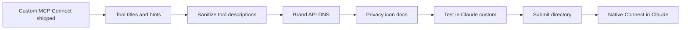

# Claude native directory connector — plan

**Status:** Planned (not built). Builds on shipped MCP Connect ([`mcp-orders.md`](mcp-orders.md)).

**Goal:** List CloseAndKeep in Claude’s **connector directory** so sellers click **Connect CloseAndKeep** with no MCP URL paste. Same OAuth + draft→confirm tools; Anthropic review required.

Custom Connect (paste `https://closeandkeep-api.onrender.com/mcp`) stays available with **no** Anthropic approval.

Fulfillment bakery autofill remains parked: [`bakery-fulfill-later.md`](bakery-fulfill-later.md).

## End-user experience (native)

1. Claude → Settings → Connectors → browse/search **CloseAndKeep**.
2. **Connect** → browser login/consent on www → back to Claude.
3. Chat: “Send 4 cookies to Dana…” → draft → seller yes → Stripe link.

No Render hostname, no custom URL field.

## What Anthropic requires (directory)

Sources: [Build an MCP server](https://claude.com/docs/connectors/building), [Authentication](https://claude.com/docs/connectors/building/authentication), [Submission](https://claude.com/docs/connectors/building/submission), [Review criteria](https://claude.com/docs/connectors/building/review-criteria), [Directory vs custom](https://claude.com/docs/connectors/building/directory-vs-custom).

### Hosting and transport

| Requirement | CloseAndKeep today | Gap |
|-------------|-------------------|-----|
| Remote HTTPS MCP (not localhost) | Live on Render | Prefer brand host `api.closeandkeep.com` (or `mcp.closeandkeep.com`) — directory wants server domain to match the product |
| Streamable HTTP | JSON-RPC `POST /mcp` | Validate against Claude as custom connector; harden Streamable HTTP / SSE if Claude rejects our dialect |
| Tool timeout ≤ ~240s (claude.ai) | Order create is short | OK |
| Tool result size modest | Caps on list limits | Keep limits; no full dumps |

### Authentication

| Requirement | Today | Gap |
|-------------|-------|-----|
| OAuth 2.0 for user-scoped tools | PKCE + DCR + CIMD flags; authorize on www | Smoke full Connect in Claude.ai before submit |
| Callback `https://claude.ai/api/mcp/auth_callback` | Allowed via DCR / CIMD redirect registration | Explicitly allowlist in docs/tests; port-agnostic localhost for Claude Code |
| 401 + Protected Resource Metadata | Implemented | Re-test from Anthropic egress |
| Token refresh | Refresh grant implemented | Claude refresh smoke test |
| Optional `oauth_anthropic_creds` | Not used | Consider for directory if DCR client sprawl becomes an issue |
| Do **not** use shared org API-key headers for per-seller orders | Correct — OAuth only for sellers | Keep `cak_` off the directory path |

### Tool design (review rejects without these)

| Requirement | Today | Gap |
|-------------|-------|-----|
| Separate read vs write tools | Already split | OK |
| Every tool has `title` | **Missing** | Add human titles |
| `readOnlyHint: true` on reads | **Missing** | Add on `list_*` / `get_*` |
| `destructiveHint: true` on mutating tools | **Missing** | Add on `create_prospect`, `confirm_gift_order` (and treat draft as non-readonly write) |
| Names ≤ 64 chars | OK | OK |
| Descriptions: what the tool does, **not** how Claude should behave | Draft description says “Restate… wait for yes” | **Rewrite** — move confirm UX to server `instructions` + product docs; descriptions must not look like prompt injection |
| Actionable errors (no bare 500/400) | Mostly OK | Audit tool error strings for review |
| First-party APIs only | Calls our FastAPI/DB | OK; brand MCP domain strengthens “API ownership” |

### Listing materials (portal)

| Asset | Status |
|-------|--------|
| Public docs URL | `/developers/ai` + this plan / USER_GUIDE |
| Privacy policy HTTPS | `/privacy` exists — **update** for MCP/AI host data sharing if incomplete |
| Support contact | Support page / email |
| Icon | Need a square connector icon (brand mark) |
| Paid Claude plan to submit | Owner / company Anthropic account |
| Test & launch confirmation | Must exercise **every** tool as a **custom** connector in Claude first |

### Policy / product fit

- Directory rejects money/crypto *transfer* connectors and AI media generators. Gift checkout handoff to Stripe (human pays) should be acceptable — frame tools as “draft/create gift order + return Checkout URL,” never “charge card.”
- Agree to Anthropic Software Directory Terms / Policy; maintain security and respond to issues.

### Community vs Verified

- Default listing: **Community** after automated scan.
- **Verified** is escalated by Anthropic when useful; they may email for a test account. MCP Apps UI needs Verified — we do **not** need an MCP App for v1 native listing.

## Gap analysis → code work

### Phase N1 — Directory-ready tools (code)

Files: [`api/app/mcp_tools.py`](../api/app/mcp_tools.py), [`api/app/mcp_routes.py`](../api/app/mcp_routes.py).

1. Add MCP tool `annotations` (or equivalent fields Claude expects) per tool:
   - Reads: `title`, `readOnlyHint: true`
   - Writes: `title`, `destructiveHint: true` for create/confirm; draft = write without destructive if reviewers prefer (document choice).
2. Rewrite descriptions to factual capability only (no “wait for yes / restate”).
3. Keep confirm gate **server-side** (`draft_id`); rely on `initialize` `instructions` + `/developers/ai` for seller UX, not tool-description puppetry.
4. Ensure `tools/list` returns annotations in the shape Claude’s client expects (match MCP schema Claude documents).
5. Expand pytest for annotation presence + description lint (no banned instruction phrases).

### Phase N2 — Brand domain + auth polish

1. DNS: `api.closeandkeep.com` (or `mcp.closeandkeep.com`) → Render; set `API_BASE_URL` / `NEXT_PUBLIC_MCP_URL` accordingly.
2. Confirm Claude callback + loopback redirects in DCR/CIMD path with a real Claude custom Connect.
3. Optional: register Anthropic-held OAuth client (`oauth_anthropic_creds`) if submission portal recommends it for directory traffic.
4. Document Anthropic egress / WAF so discovery and token endpoints stay reachable.

### Phase N3 — Listing pack (non-code + light web)

1. Privacy policy section: AI hosts + MCP OAuth tokens + recipient PII.
2. Connector icon asset + support email.
3. Short public “Connect with Claude” help URL (can be `/developers/ai` once native copy lands).
4. Owner: paid Claude account; create portal listing (MCP connector, remote URL).

### Phase N4 — Pre-submit Claude QA

As custom connector (before portal):

1. Connect with brand or Render URL.
2. Call every tool with valid args; confirm structured success.
3. Invalid args → clear errors.
4. Confirm `confirm_gift_order` without draft fails; Stripe URL only from API.
5. Disconnect / revoke works.

### Phase N5 — Submit and iterate

1. Developer portal → MCP connector → paste HTTPS MCP URL + OAuth type + materials.
2. Confirm Test & launch checklist.
3. Respond to Community/Verified feedback; provide test login if asked.
4. Update `/developers/ai` Claude card: **Connect from directory** primary; custom URL secondary.

## Out of scope

- ChatGPT / Cursor marketplace listings (separate plans; reuse N1–N2).
- MCP App interactive UI (needs Verified; not required for native Connect).
- Removing custom connector path.
- Bakery vendor API / parked Crumbl autofill.

## Success criteria

- Seller finds **CloseAndKeep** in Claude’s directory and Connects without pasting a URL.
- Same safety model: draft → confirm → human Stripe pay; no PAN.
- Tools pass Anthropic annotation + description rules.
- MCP hostname is first-party CloseAndKeep DNS.

## Owner calls

- When to buy/submit (paid Claude + portal time).
- Brand hostname: `api.` vs `mcp.` subdomain.
- Whether to pursue Verified (test account for Anthropic) or stop at Community.
