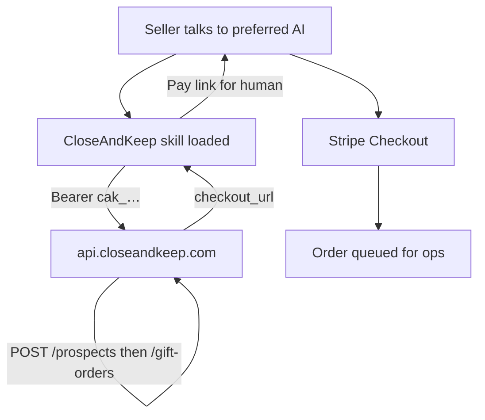

# Draft: Headless orders via preferred AI

Draft 2026-11-16. **Not built yet** — design only. The HTTP API already supports agent/script orders; this draft packages that as a portable **skill** so sellers place gifts from Cursor, Claude, ChatGPT, or any other AI that can call HTTPS and hold a secret.

Fulfillment stays manual in `/admin` for now. Owner bakery autofill (Crumbl → Levain) remains parked separately in [`bakery-fulfill-later.md`](bakery-fulfill-later.md). Do not start a bakery vendor API here.

## Goal

A salesperson says something like:

> Send 4 cookies to Dana Buyer at dana@acme.com — thanks for today's demo.

Their **preferred AI** (with this skill + their `cak_` key) creates the prospect and gift order through CloseAndKeep, then hands them a Stripe Checkout link (or confirms monthly billing). Cards never enter the AI chat.



## What already exists (reuse)

| Piece | Status |
|-------|--------|
| Bearer API keys (`cak_…`) | Live — dashboard **API keys** |
| `GET /gifts` | Live — pack ids + prices |
| `POST /prospects`, `GET|PATCH /prospects…` | Live |
| `POST /gift-orders` (+ address request / structured ship-to) | Live |
| `GET /gift-orders`, `GET /gift-orders/{id}` | Live |
| Checkout URL or monthly `checkout_url: null` | Live |
| Public docs | [`/developers`](https://www.closeandkeep.com/developers) |
| Custom-CRM paste prompt | [`custom-crm-setup.md`](custom-crm-setup.md) (CRM button, not conversational AI) |

**Product gap:** no first-class **installable skill**, no one-page “use with your AI” setup, and the custom-CRM doc targets deal-page buttons — not “talk to Claude/Cursor and place an order.”

## Product shape

### 1. Same API (headless)

No new order model. Agents use the existing authenticated surface:

1. `Authorization: Bearer cak_…`
2. `POST /prospects` (or reuse a known `prospect_id`)
3. `POST /gift-orders` with note + either structured address **or** `request_recipient_address: true`
4. Show `checkout_url` to the human, or say monthly billing queued when null
5. Optional: `GET /gift-orders/{id}` for status

Hard rules (skill + docs must repeat):

- Never ask for or transmit PAN / CVV / bakery passwords.
- Never call admin routes with a seller API key.
- Notes max **150** characters (Crumbl gift-note limit).
- Packs: `cookies-4` (default) or `cookies-12`.
- Street / city / state / ZIP are required **together**, or omit all four and request address by email.

### 2. Portable skill

Ship a small skill folder sellers drop into whatever agent host they use:

```text
closeandkeep-orders/
  SKILL.md          # when to run, setup, API flow, safety
  references/
    api-cheat-sheet.md   # optional compact endpoint table
```

**SKILL.md** follows the usual agent-skill pattern (`name` + `description` frontmatter, imperative body). Hosts that understand skills (Cursor, Claude Code / Projects, etc.) auto-route; others paste `SKILL.md` into project instructions / a custom GPT.

Draft body to ship when this is reopened — copy into `closeandkeep-orders/SKILL.md`:

````markdown
---
name: closeandkeep-orders
description: >-
  Place CloseAndKeep post-pitch cookie gifts via the HTTP API. Use when the user
  wants to send cookies, create a gift order, thank someone after a demo, or set
  up CloseAndKeep with an API key in Cursor, Claude, ChatGPT, or another agent.
---

# CloseAndKeep orders

## Setup (once)

1. Seller creates a real account at https://www.closeandkeep.com (not guest).
2. Dashboard → **API keys** → create a key (`cak_…`). Shown once.
3. Store as secret `CLOSEANDKEEP_API_KEY` (or host equivalent). Never commit it; never paste it into chat logs the seller will share.
4. Optional: Profile → **Pay monthly** so create-order returns no Checkout URL.

Base URL: `https://api.closeandkeep.com`  
Docs: https://www.closeandkeep.com/developers

## When the user asks to send cookies

Collect (ask only for what is missing):

- Recipient **name** and **email** (email required for address-request path)
- Pack: 4 (default) or 12 → `cookies-4` / `cookies-12`
- Gift **note** (≤150 chars). Default: `Thanks for meeting with us — enjoy these cookies!`
- Shipping: either full street + city + state + ZIP (+ optional company / street2), or none → set `request_recipient_address: true`

Then call the API with `Authorization: Bearer $CLOSEANDKEEP_API_KEY` and `Content-Type: application/json`.

### 1) Prospect

`POST /prospects`

```json
{ "name": "<name>", "email": "<email>", "deal_status": "open" }
```

Save returned integer `id`. If the user already gave a CloseAndKeep prospect id, skip create.

### 2) Gift order

`POST /gift-orders`

With address:

```json
{
  "prospect_id": 123,
  "gift_id": "cookies-4",
  "recipient_name": "<name>",
  "shipping_company": "<optional>",
  "shipping_street": "<street>",
  "shipping_street2": "<optional>",
  "shipping_city": "<city>",
  "shipping_state": "<ST>",
  "shipping_postal_code": "<zip>",
  "note": "<note ≤150 chars>"
}
```

Without address (email recipient for `/ship` link):

```json
{
  "prospect_id": 123,
  "gift_id": "cookies-4",
  "recipient_name": "<name>",
  "note": "<note>",
  "request_recipient_address": true,
  "recipient_email": "<email>"
}
```

### 3) Tell the seller what happened

- If `checkout_url` is a string → give them that link to pay (open in browser). Do not scrape or complete Checkout yourself.
- If `checkout_url` is null → monthly billing is on; confirm “Cookies queued — billed monthly.”
- On 401 → key missing/revoked. On 429 → backoff. Surface API error bodies.

Optional: `GET /gifts` for live prices; `GET /gift-orders/{id}` for `payment_status` / `status`.

## Do not

- Store or request card numbers.
- Use Salesforce/HubSpot OAuth flows (those are dashboard Integrations).
- Call `/admin/*`.
- Invent gift ids other than `cookies-4` / `cookies-12`.
- Place a bakery order or open Crumbl/Levain (ops fulfillment is separate).
````

### 3. Setup page / install story (when building)

Add a short marketing or dashboard path (e.g. `/developers/ai` or an **Use with AI** panel on **API keys**):

1. Create key  
2. Download / copy skill (`closeandkeep-orders.zip` or raw `SKILL.md`)  
3. Host-specific one-liners:
   - **Cursor:** drop folder under `.cursor/skills/` or project skills; set secret `CLOSEANDKEEP_API_KEY`
   - **Claude:** add skill / project instruction + secret
   - **ChatGPT:** custom GPT instructions = skill body; Action or user pastes key into a secret store the GPT can read — prefer “user supplies key in their connector,” never bake keys into shared GPTs
4. Smoke phrase: “Send a test 4-pack to me at my email with note ‘AI skill test’”

Keep [`custom-crm-setup.md`](custom-crm-setup.md) for CRM **Send cookies** buttons. Link both from `/developers`: **Agent skill** vs **Custom CRM**.

## Example seller sessions

**Address known**

> User: Send a dozen cookies to Priya Shah, priya@northwind.io, 500 W Madison Ste 1000, Chicago IL 60661. Note: Great discovery call.  
> Agent: Creates prospect + `cookies-12` order → returns Checkout link (or monthly confirmation).

**Address unknown**

> User: Cookies to Jordan Lee after the demo — jordan@example.com — I don’t have their office address.  
> Agent: `request_recipient_address: true` → Checkout (if needed) → recipient gets `/ship/[token]`.

**Status**

> User: Did that gift for Dana pay yet?  
> Agent: `GET /gift-orders?` / by id → report `payment_status` and `status`.

## Out of scope for this draft

- Bakery vendor API or Cursor/Playwright checkout on Crumbl/Levain (see parked fulfill doc).
- Letting the AI complete Stripe Checkout or hold card data.
- Auto-order-on-CRM-stage (OAuth Integrations only today).
- Team wallets / shared org keys (solo-user first).
- Changing gift catalog or note length.

## When building (checklist)

1. Add repo path `skills/closeandkeep-orders/SKILL.md` (publishable copy of the draft above).
2. Link from [`/developers`](https://www.closeandkeep.com/developers) + API keys empty state: **Use with your AI**.
3. Optional zip download for non-git users.
4. One pytest (or docs fixture) that the skill’s example JSON still matches `GiftOrderCreateRequest`.
5. Mention in `USER_GUIDE.md` under API / integrations only after it ships.
6. Leave bakery fulfill parked unless the owner reopens it.

## Relationship to other docs

| Doc | Audience |
|-----|----------|
| This draft | Headless + preferred-AI skill |
| [`custom-crm-setup.md`](custom-crm-setup.md) | Human + Claude wiring a CRM **button** |
| [`bakery-fulfill-later.md`](bakery-fulfill-later.md) | Owner ops autofill (parked) |
| [`next-feature-brief.md`](next-feature-brief.md) | Priority list |
