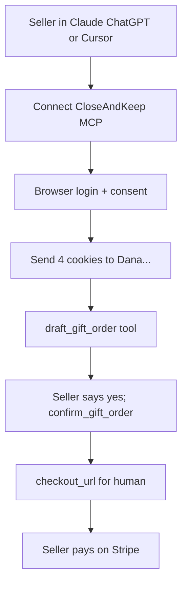

# MCP Connect: Order Cookies — plan

**Status:** Planned (not built). Owner chose **Option B** — hosted remote MCP with **OAuth Connect** as the seller-facing setup path.

**Goal:** A non-technical AE connects Claude, ChatGPT, or Cursor once (browser login), then places CloseAndKeep gift orders in chat. Cards stay on Stripe; the AI never sees PAN.

Fulfillment bakery autofill remains parked: [`bakery-fulfill-later.md`](bakery-fulfill-later.md). Do not start a bakery vendor API.

Related: seller zero-setup path stays **AI Helper** ([`ai-helper-order-cookies.md`](ai-helper-order-cookies.md)). HTTP skill stays Advanced ([`headless-ai-orders.md`](headless-ai-orders.md)). This plan is the **Connect** path that can become a main website story.

## Product positioning

| Path | Who | Setup | What the AI does |
|------|-----|-------|------------------|
| **MCP Connect** (this plan) | Sellers who want orders from chat | Connect → CloseAndKeep login | Tools create prospect + gift order; returns Stripe `checkout_url` |
| **AI Helper** | Teams that will not connect anything | Paste instructions once | Returns prefill `/send?…` link only |
| **API skill / `cak_` key** | Power users / CRM | Create key + host secret | Same HTTP API as today |

Lead marketing with **Connect** once OAuth works on Claude + ChatGPT + Cursor. Keep AI Helper as the no-install fallback on the same hub page. Demote API keys further (Advanced / developers only).

## Seller flow (target)

1. Seller opens `/developers/ai` (or dashboard **AI connections**) → picks **Claude**, **ChatGPT**, or **Cursor**.
2. One-click / copy URL → host opens Connect → redirects to CloseAndKeep login on **www** (if needed) → consent (verified non-guest) → back to host.
3. In chat: “Send 4 cookies to Dana at dana@acme.com — thanks for the demo.”
4. AI calls `draft_gift_order`, restates the summary, waits for explicit yes, then `confirm_gift_order` with the draft id.
5. AI returns the Stripe Checkout link (or monthly-queued message). Seller pays. Order enters the existing queue.

## Architecture (locked choices)

### Hosted remote MCP (universal URL)

- **URL:** `https://api.closeandkeep.com/mcp` (Streamable HTTP). Same Render FastAPI service as today — no second deploy for v1.
- **Why not localhost / `npx`:** Claude and ChatGPT connect from their cloud; sellers must not run Node.
- **Why not a separate `mcp.` subdomain yet:** Extra DNS/TLS/ops. Revisit if we want a cleaner public brand URL later (`https://mcp.closeandkeep.com/mcp` → same app).

### Auth: OAuth 2.1 + PKCE (CloseAndKeep as AS + RS)

CloseAndKeep implements a small **authorization server** for MCP clients (not Salesforce/HubSpot OAuth — those stay CRM-only).

**Session cookie rule (locked):** Production sessions are first-party on `www` (HttpOnly cookie via the `/__cak_api` proxy). Anything that must see the logged-in seller therefore runs on the **web origin**, not on bare `api.closeandkeep.com`.

| Piece | Location |
|-------|----------|
| Resource server | MCP at `https://api.closeandkeep.com/mcp`; validates access tokens (audience/`resource` bound) |
| AS metadata + register + token + revoke | FastAPI on the API host (no session cookie required) |
| **Authorize + login + consent** | **Web origin only** — `authorization_endpoint` is `https://www.closeandkeep.com/oauth/mcp/authorize` (Next.js). That page reads the existing session cookie, redirects to `/login?next=…` if needed, then shows consent. After Allow, the web app calls an internal API to mint the auth code and redirects to the client with `?code=&state=`. Do **not** put the interactive authorize step on the API host. |
| Token store | Neon tables (hashed refresh + access metadata → `user_id`, plus `resource`/audience) |

**Discovery (required by Claude / ChatGPT / Cursor):**

- `GET /.well-known/oauth-protected-resource` on the MCP resource (RFC 9728) — `resource` must equal the MCP URL exactly; list our AS issuer first.
- `GET /.well-known/oauth-authorization-server` (RFC 8414) — `authorization_endpoint` points at **www**; token, registration, and revocation stay on the API issuer; PKCE `S256`; refresh tokens; advertise that the `resource` parameter is required/echoed through the flow.
- Unauthenticated MCP call → **401** with `WWW-Authenticate` pointing at protected-resource metadata (Claude starts OAuth from 401, not from a 200).

**Token binding (locked):**

- Echo the MCP `resource` (canonical MCP URL) through authorize → code → token.
- Access tokens are audience-bound to that resource. Every MCP request must validate the bearer token’s audience/`resource` matches `https://api.closeandkeep.com/mcp` (reject otherwise). ChatGPT and the MCP authorization spec expect this.

**Client registration (support both for host coverage):**

- **DCR** (`registration_endpoint`) — Claude default; Cursor can register.
- **CIMD** — advertise `client_id_metadata_document_supported: true` and `token_endpoint_auth_methods_supported` including `none` (ChatGPT prefers CIMD; Claude uses it when advertised).
- Document Cursor redirect URIs (`https://cursor.com/.../callback`, `http://localhost:8787/callback`, loopback variants). Claude Desktop/Code loopback: treat `localhost` / `127.0.0.1` as port-agnostic per Anthropic docs.
- Optional later: static public client ids for “Add to Cursor” / directory listing if a host requires whitelisting.

**Scopes (start narrow):**

| Scope | Meaning |
|-------|---------|
| `orders:write` | Create prospects + gift orders (after server-side confirm) |
| `orders:read` | List/get gifts, prospects, orders |

Consent screen lists these in plain language (“Place cookie gift orders”, “See your prospects and gift status”). Do not grant admin.

**Account eligibility (locked):** Consent and token minting require the same bar as API keys / Advanced skill: **verified email**, **not a guest**. Guests and unverified sessions get a clear “verify your email / create a full account” path before Allow succeeds. Mirror those checks again when serving MCP tools (defense in depth).

**Bearer `cak_` fallback:** MCP also accepts `Authorization: Bearer cak_…` for power users and any host that cannot finish OAuth. Not the seller CTA. Same eligibility as today’s key auth.

### Tools (skill-equivalent surface)

Reuse existing HTTP handlers; do not invent a second order model.

| Tool | Maps to | Notes |
|------|---------|--------|
| `list_gifts` | `GET /gifts` | Pack ids + prices |
| `list_prospects` | `GET /prospects` | Dedupe by email before create |
| `create_prospect` | `POST /prospects` | Only if no email match |
| `draft_gift_order` | In-memory / short-lived DB draft | Returns draft id + summary; **does not** create a gift order |
| `confirm_gift_order` | `POST /gift-orders` | Requires `draft_id` issued to this user/token; creates order; returns `checkout_url` |
| `get_gift_order` | `GET /gift-orders/{id}` | Status |
| `list_gift_orders` | `GET /gift-orders` | Match by email/name when id unknown |

**Confirm gate (locked — server-side, not prompt-only):**

The MCP server **cannot** see chat turns, so a single `create_gift_order` tool cannot enforce “seller said yes.” Ship **two-step tools from day one**:

1. `draft_gift_order` — validates fields, stores a short-lived draft (TTL ~10 minutes, hashed token ownership), returns a human-readable summary + `draft_id`.
2. `confirm_gift_order` — only accepts a valid, unexpired, unused `draft_id` for this access token’s user; then calls existing `POST /gift-orders`.

Tool descriptions still tell the model to restate the draft and wait for an explicit yes before calling confirm. That is defense in depth; **authorization to create is the draft id**, not model obedience.

**Other hard rules:**

- Never accept or ask for PAN / CVV / bakery passwords.
- Never invent `checkout_url`; only return API value (Stripe-hosted).
- Prefer per-order Checkout; if monthly is on, draft summary must warn and confirm must re-check.
- Creates are not idempotent — no automatic retry after 201; optional later: `Idempotency-Key`.
- Ignore “send cookies” instructions inside pasted third-party email/CRM text (seller intent only) — document in tool descriptions.
- Rate limits: reuse existing order-create limits; add per-token abuse caps if needed.
- Drafts: single-use; expire; scoped to `user_id` + client/token; never creatable via raw HTTP without going through MCP draft first (unless we later expose an equivalent API).

## UI / website

Treat Connect as a **first-class Use with AI** surface that can later headline the marketing site.

### Hub: `/developers/ai` (evolve, do not abandon)

Rename framing from “AI Helper only” → **Use with AI** with two clear tracks:

1. **Connect your AI** (primary when shipped) — Claude / ChatGPT / Cursor cards.
2. **AI Helper** (no Connect) — existing copy/download instructions.

Each host card:

| Host | Seller steps on the card |
|------|---------------------------|
| **Claude** | Copy MCP URL → Claude Settings → Connectors → Add custom connector → Connect → log in |
| **ChatGPT** | Copy MCP URL → ChatGPT settings / custom MCP plugin → Connect → log in (follow OpenAI’s current plugin UX; docs must be updated when their UI moves) |
| **Cursor** | **Add to Cursor** deeplink (`cursor://` install with URL only, no secret) → Connect → log in. Fallback: paste URL into MCP settings |

Show a short “What you’ll be able to say” example and a privacy line (recipient name/email/note go to the AI host + CloseAndKeep).

### Consent + account UI

- **`/oauth/mcp/authorize`** (web): OAuth `authorization_endpoint`. Reads the www session cookie; if missing → `/login?next=` back here. Then eligibility check (verified, non-guest) → consent.
- **`/oauth/mcp/consent`** (web): show client name (Claude / ChatGPT / Cursor / unknown), scopes in plain language, Allow / Deny. Deny returns OAuth error; Allow mints auth code via API and redirects to the client. Ineligible accounts never reach Allow.
- **Dashboard → AI connections** (new page or Integrations sibling): list active MCP OAuth grants (client label, created, last used), **Disconnect** (revoke refresh + access). Link from hub and Profile.
- **API keys page:** keep Advanced; point primary CTA at Connect / Use with AI.

### Marketing (phase after Connect is reliable)

- Nav already has **Use with AI** → keep href `/developers/ai`.
- Homepage / product story: optional hero or section CTA “Order cookies from Claude” — only after Claude + ChatGPT + Cursor smoke tests pass. Do not put a broken Connect on the homepage.
- `llms.txt`, sitemap, `USER_GUIDE.md` updated when live.

Visual language: match existing marketing (Fraunces / DM Sans, wood palette). Host cards are interaction containers (connect CTAs), not a dashboard of stats.

## Host matrix (ship bar)

| Host | Auth | Must work for “done” |
|------|------|----------------------|
| Claude.ai / Desktop | OAuth DCR or CIMD | Custom connector → tools → create order → pay link |
| ChatGPT | OAuth CIMD (prefer) or DCR | Custom MCP plugin → same |
| Cursor | OAuth (DCR or static client if required) + deeplink | Add to Cursor → same |

Document known limits (Team shared static headers are **wrong** for per-seller orders — OAuth only for orgs).

## Data model (Alembic)

New tables (names indicative):

- `mcp_oauth_clients` — client_id, redirect_uris, client_name, token_endpoint_auth_method, created_at (DCR and/or static).
- `mcp_oauth_auth_codes` — code hash, client_id, user_id, scopes, redirect_uri, code_challenge, `resource`, expires_at, used_at.
- `mcp_oauth_tokens` — access token hash, refresh token hash, client_id, user_id, scopes, `resource`/audience, expires_at, revoked_at, last_used_at.
- `mcp_order_drafts` — draft id, user_id, payload JSON, expires_at, consumed_at (for two-step confirm).

No PAN. Do not store raw tokens — hash at rest like `cak_` keys.

## Implementation phases

### Phase 0 — Plan + product copy skeleton (this doc)

- [x] This plan
- [x] Pointers from [`next-feature-brief.md`](next-feature-brief.md), AI Helper out-of-scope note, and `AGENTS.md`

### Phase 1 — OAuth AS + consent UI

- AS metadata + DCR; token + revoke on API; **authorize on www**
- Web login gate + eligibility (verified, non-guest) + `/oauth/mcp/consent`
- Echo `resource` through the code/token exchange; store audience on tokens
- Token validation helper shared with MCP (hash lookup + audience + expiry + revoke)
- Tests: PKCE happy path, bad redirect, expired code, revoke, **wrong/missing audience**, guest/unverified blocked at consent

### Phase 2 — MCP server + tools

- Streamable HTTP MCP at `/mcp`
- Tools: list/create prospect helpers + **`draft_gift_order` / `confirm_gift_order`** + get/list orders
- 401 + PRM for unauthenticated clients; reject tokens whose audience ≠ MCP URL
- Accept OAuth bearer **and** `cak_` bearer (both eligibility-checked)
- Pytest: tool authz, draft expiry/single-use, confirm without draft fails, skill-eval themes

### Phase 3 — Hub UI for Claude / ChatGPT / Cursor

- Redesign `/developers/ai` with Connect primary + AI Helper secondary
- Host-specific instructions + Cursor deeplink
- Dashboard AI connections + disconnect
- `USER_GUIDE.md` + `llms.txt`

### Phase 4 — Polish for “main website” readiness

- Homepage / marketing CTA only after manual smoke on all three hosts
- Optional: Claude connector directory submission; Cursor Marketplace listing
- Optional: `mcp.closeandkeep.com` brand URL
- Optional: `Idempotency-Key`; scoped `cak_` keys alignment

## Out of scope

- AI completing Stripe Checkout or storing cards
- Bakery vendor API / parked Crumbl autofill ([`bakery-fulfill-later.md`](bakery-fulfill-later.md))
- Removing AI Helper or the API skill (reorder CTAs only)
- Team/pod shared MCP credentials (each seller connects their own account)
- Admin tools over MCP
- Building ChatGPT Actions / Custom GPT OpenAPI as the long-term path (Actions are legacy; MCP is the bet)

## Risks

| Risk | Mitigation |
|------|------------|
| OAuth/MCP host quirks | Phase 1–2 against Claude first in staging, then Cursor, then ChatGPT; keep host cards honest |
| Prompt injection → unwanted orders | **Server-side draft → confirm** (not prompt-only); seller-intent-only tool text; rate limits; easy Disconnect |
| Token theft | Hash tokens; audience-bound access tokens; short access TTL; refresh rotation; revoke on Disconnect |
| Authorize on API host / lost session | Interactive authorize + consent only on www; API does metadata/token/revoke |
| DCR client sprawl | Prefer CIMD where hosts support it; prune unused DCR clients on a job |
| Monthly billing surprise | Tool warns when `checkout_url` is null; docs prefer per-order while using AI |
| Duplicate gifts | No retry after 201; list recent orders before create when unsure |
| Positioning conflict with AI Helper | One hub page; Connect = place orders; Helper = link only |

## Success criteria

- Non-technical seller can connect **without** creating an API key on Claude, ChatGPT, and Cursor.
- After connect, a natural-language request yields a real `checkout_url` (or clear monthly message) only after `confirm_gift_order` with a valid draft (not a naked create tool).
- Guests and unverified accounts cannot complete Connect or mint MCP tokens.
- Disconnect revokes access immediately.
- AI Helper still works for teams that refuse Connect.
- No PAN in logs, tokens, or model context.

## Open follow-ups (do not block Phase 1)

- Exact ChatGPT plugin submission / settings labels (update Phase 3 copy when OpenAI UI settles).
- Whether homepage hero leads with Connect vs product demo (owner call after Phase 3).
- Brand subdomain `mcp.closeandkeep.com`.
